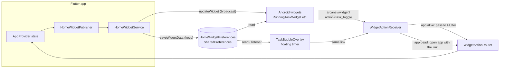

# How Arcane's home-screen widgets get the running task

This explains how the running task (the one with the timer) reaches the home screen, the floating
timer bubble, and the widgets. It covers both the in-app launcher and any external launcher, such as
the stock Pixel home screen. It was written from reading the code. The behaviour has not been
measured on a phone.

## The short version

1. The Flutter app computes the task state and **writes it into one shared key-value store** on the
   phone: Android's `SharedPreferences` file called `HomeWidgetPreferences`.
2. It then **tells Android to redraw** the widgets.
3. Every consumer reads that same store: the widgets, the floating bubble, and the foreground
   notification service.
4. When a user taps a button on a widget or the bubble, the tap travels **back** to the app as a
   small `arcane://widget?action=...` link.

Nothing talks to the app directly. The store is the only shared memory.



## Step 1: the app decides what the task state is

`lib/src/services/home_widget_publisher.dart` listens to `AppProvider`. Each time the app state
changes, it asks for a republish. The publish is debounced by 400 ms, and it is skipped when nothing
has changed.

There is also a **heartbeat every 30 seconds**. It re-checks the task state, and every 5 minutes it
forces a full rewrite. The forced rewrite exists because a single missed or failed write must not
leave a stale "running" clock on screen.

Two things can publish the state straight away: the user tapping a bubble or widget button
(`republishNow`), and a Widgets Studio preview being pushed (`restoreLiveTimerState` puts the live
timer back afterwards).

## Step 2: writing the state into the shared store

`lib/src/services/home_widget_service.dart` builds a flat map of keys and writes each one with
`HomeWidget.saveWidgetData`. Everything for the running task lives under the `arcane.task.` prefix:

| Key | Meaning |
| --- | --- |
| `arcane.task.hasTask` | Is there a task to show at all? |
| `arcane.task.isRunning` | Is the timer running right now? |
| `arcane.task.title` / `subtitle` | Task name and the line under it |
| `arcane.task.sessionStartMs` | When the current running session began (epoch ms). The clock is calculated from this. |
| `arcane.task.accumulatedSec` | Seconds already logged before this session |
| `arcane.task.pausedAtMs` | When the timer was paused (used for the 10-minute "paused" grace) |
| `arcane.task.isCheckpoint`, `nextCheckpoint` | The next checkpoint, for the "check next" button |
| `arcane.task.progressPct`, `capacity` | Progress bar and load |
| `arcane.task.dp0..dp4.title` | Day-plan entries (the queue) |
| `arcane.task.mt0..mt2.*` | Multitask entries: title, parent, checkpoints |
| `arcane.task.updatedAtMs` | **Always written last.** Its arrival tells the bubble that everything else is in place. |

Writing the timestamp last matters. The bubble listens only for that key, so it never reads a
half-written state.

Other slices use the same pattern with their own prefixes: `arcane.fin.*` (finance),
`arcane.bus.*` (bus), `arcane.goals.*` (goals), plus `arcane.theme` for colours.

## Step 3: telling Android to redraw

After the values are saved, the service calls `HomeWidget.updateWidget` with the provider's class
name, for example `me.ihjas.missions.widgets.RunningTaskWidget`. That sends a broadcast. Android then
calls `onUpdate` on each widget provider, and the provider re-reads the store and builds the
`RemoteViews` it shows.

Providers are declared in `AndroidManifest.xml` and live in
`android/app/src/main/kotlin/me/ihjas/missions/widgets/`:
`RunningTaskWidget`, `DayPlanWidget`, `FinanceWidget`, `JournalWidget`, `BusWidget`, `GoalsWidget`.
Shared helpers are in `WidgetCommon.kt`. They read the same prefs file, and they include the
`getSafe*` readers and the action intents.

Each provider also has an `updatePeriodMillis` of 30 minutes (in `res/xml/widget_*_info.xml`). That
is a fallback: if the app never sends a broadcast, the widget still refreshes at least every 30
minutes.

### How the running clock ticks without the app

`RunningTaskWidget.renderRunning` does not store a changing number. It reads
`arcane.task.sessionStartMs` and sets an Android **Chronometer** to that base time. The home screen
then counts up by itself, with no app process running. The bubble does the same thing with its own
drawing code.

## Step 4: the consumers

**External launchers (e.g. Pixel home).** The launcher is only a host. It asks Android for the
provider's `RemoteViews`, shows them, and forwards clicks back to our `PendingIntent`s. It does not
read our data at all. Updates arrive when our app sends a broadcast, or when the 30-minute timer
fires.

**Arcane's own launcher.** `lib/src/screens/launcher/` hosts the same Android widgets through
`LauncherBridge.kt` (an `AppWidgetHost`). So it gets exactly the same data as an external launcher.
Choosing a widget goes through `LauncherNative.addWidget`, and previews are produced by
`getWidgetPreview`.

**The floating timer bubble.** `TaskBubbleOverlay.kt` is drawn by the "Arcane Launcher"
accessibility service, and it only shows while a task is running. It reads the same prefs keys
(`WidgetCommon.prefs`). It registers a `SharedPreferences` listener, and reacts only to
`arcane.task.updatedAtMs`, after a 150 ms debounce. That is how it refreshes without polling.

**The foreground service.** `TaskForegroundService.kt` keeps the app alive while a task runs. It
does not read the task keys. Its only link to the widgets is a launch intent, used when the
notification is tapped.

**The in-app Flutter widgets.** `lib/src/widgets/homescreen_widgets.dart` renders offscreen PNGs
with `HomeWidget.renderFlutterWidget`. These are previews for the widget picker, not live widgets.

## Step 5: taps coming back to the app

A button on a widget or the bubble does not change the app directly. Each button fires a link:

```
arcane://widget?action=task_toggle        (ENGAGE / HALT)
arcane://widget?action=task_check_next    (CHECK NEXT)
arcane://widget?action=task_finish        (FINISH)
```

Two receivers can handle the link:

- **`WidgetActionReceiver.kt`** runs first. It applies a quick "instant feedback" change to the
  store, so the widget responds at once. Then:
  - If the app is alive, it passes the action to Flutter with `MainActivity.dispatchWidgetAction`.
  - If the app is not running, it starts the app with the link. The Flutter side reads the link at
    cold start (`HomeWidget.initiallyLaunchedFromHomeWidget`).
- **Flutter `WidgetActionRouter`** (`lib/src/services/widget_action_router.dart`) maps the action
  name to the real operation (for example `task_toggle` starts or pauses the timer). The change
  then goes through the normal publish, so the widgets and bubble end up showing the same state.

Some buttons open the app instead (OPEN PLAN, OPEN TASK). Those use `HomeWidgetLaunchIntent`.

## Timing you can expect

| Event | Typical delay |
| --- | --- |
| Tap ENGAGE on a widget | Immediate visual change from the receiver; app state follows once Flutter handles the action |
| Change made inside the app | About 0.4 s debounce, then the widgets redraw |
| Bubble after a task changes | About 150 ms after `updatedAtMs` is written |
| Any widget with nothing changing | Refreshes every 30 minutes (provider fallback) |
| Missed publish | Corrected by the 30 s heartbeat, forced every 5 min |

## Things to know

- **Data is only as fresh as the last write.** If the app is killed and no broadcast arrives, the
  widgets show the last saved state. A running timer still counts correctly, because it is calculated
  from `sessionStartMs`.
- **Plain SharedPreferences.** The values are not encrypted. They include task titles.
- **Keys are shared by name.** Renaming a key in Dart without changing the Kotlin readers silently
  shows empty values. `WidgetCommon.kt`, `RunningTaskWidget.kt`, `DayPlanWidget.kt` and
  `TaskBubbleOverlay.kt` depend on the `arcane.task.*` names.
- **Order matters for the bubble.** Anything that makes the bubble read the store must write
  `updatedAtMs` last. Otherwise it can show a half-written state.
- **Not measured on a device.** The timings above come from the code (debounces, heartbeat and
  update periods). Real delays depend on the launcher and on Android's battery rules.

## Where to look

| Piece | File |
| --- | --- |
| Decide what the state is, when to publish | `lib/src/services/home_widget_publisher.dart` |
| Write keys, trigger redraws | `lib/src/services/home_widget_service.dart` |
| Route taps from the widget and bubble | `lib/src/services/widget_action_router.dart` |
| Widget providers | `android/app/src/main/kotlin/me/ihjas/missions/widgets/*.kt` |
| Shared readers and action intents | `.../widgets/WidgetCommon.kt` |
| Widget declarations and update periods | `android/app/src/main/AndroidManifest.xml`, `res/xml/widget_*_info.xml` |
| Bubble (floating timer) | `android/app/src/main/kotlin/me/ihjas/missions/TaskBubbleOverlay.kt` |
| Launcher hosting of widgets | `android/app/src/main/kotlin/me/ihjas/missions/LauncherBridge.kt` |
| Foreground service (keeps app alive) | `android/app/src/main/kotlin/me/ihjas/missions/TaskForegroundService.kt` |
